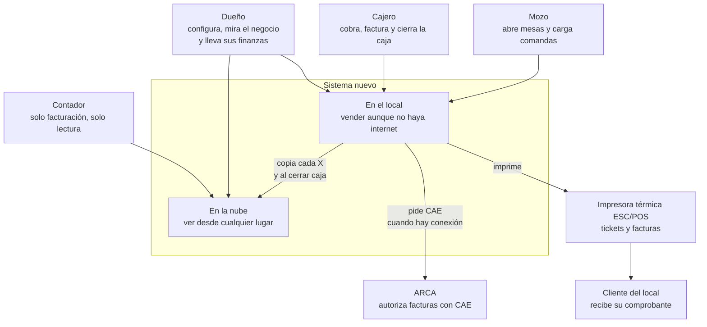
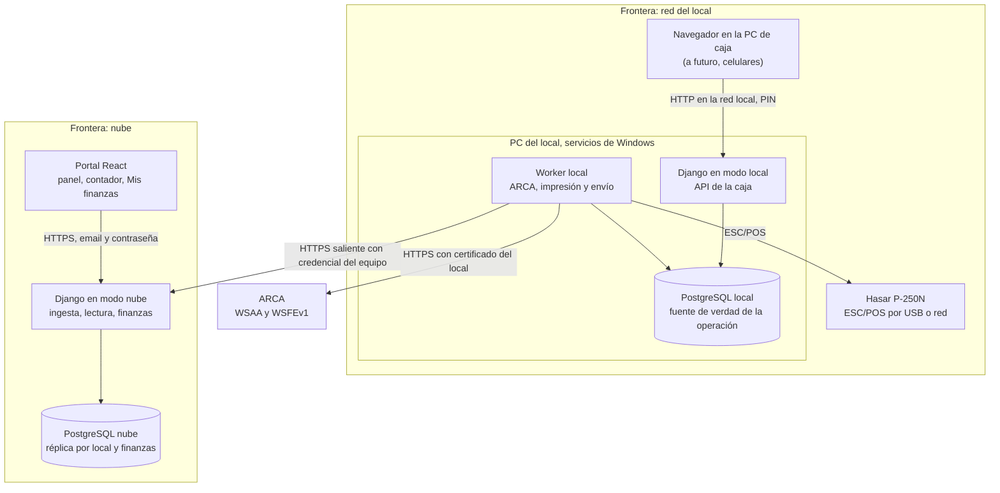
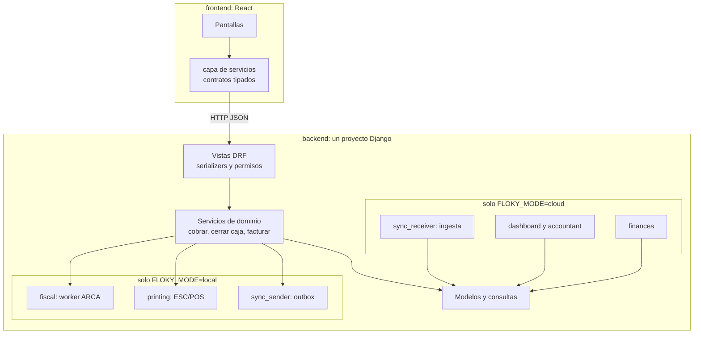
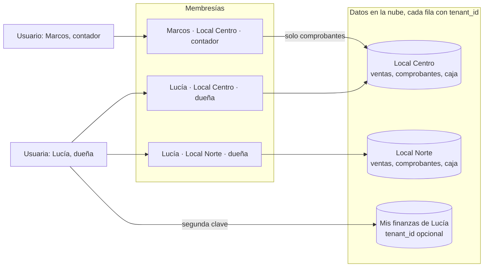
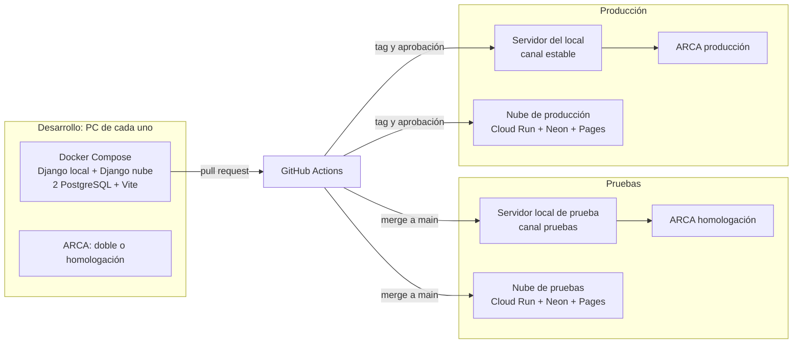

# Arquitectura: del local a la nube

**Estado: arquitectura objetivo, todavía no implementada.**

Cinco dibujos para explicar el sistema en niveles: para quién existe, qué piezas corren y dónde, cómo se ordena el código, cómo se separan los locales y por qué entornos pasa un cambio. No reemplazan a los ADR: todos los ADR están en propuesta ([índice](../adr/README.md)).

## ARQ-01. Contexto y actores

**Propósito:** presentar el sistema sin hablar de tecnología. **Stories:** HU-110, HU-140, HU-162, HU-181, HU-200, HU-211.

<!-- diagram: ARQ-01 -->

**Archivos ARQ-01:** [SVG](svg/ARQ-01.svg) · [PNG](png/ARQ-01.png) · [Mermaid](fuentes/ARQ-01.mmd).

**Lectura:** el personal trabaja contra el local; el dueño usa los dos lados; el contador solo la nube. La flecha del local a la nube va en un solo sentido para la operación (ADR-0005).

**Casos para validar:** sin internet el mozo y el cajero siguen trabajando; el contador nunca entra al local; el dueño ve desde afuera los datos hasta el último envío.

## ARQ-02. Contenedores: qué corre en el local y qué en la nube

**Propósito:** ubicar cada pieza que se ejecuta por separado y las fronteras de confianza. **Stories:** HU-232, HU-250, HU-251, HU-252, HU-103.

<!-- diagram: ARQ-02 -->

**Archivos ARQ-02:** [SVG](svg/ARQ-02.svg) · [PNG](png/ARQ-02.png) · [Mermaid](fuentes/ARQ-02.mmd).

**Lectura:** el servidor local nunca se publica a internet: todas sus conexiones hacia afuera son salientes. La nube no puede llamar al local; el local le pregunta a la nube su configuración cuando sincroniza.

| Pieza | Qué tiene que sostener |
|---|---|
| Django local | Reglas de dinero, permisos por rol, transacción con auditoría y outbox |
| Worker local | Nunca frenar la caja: ARCA, impresión y envío van por colas |
| Django nube | Aislamiento entre locales, ingesta idempotente, solo lectura para el contador |

## ARQ-03. Un código Django, dos modos

**Propósito:** mostrar cómo se ordena el código para que lo mismo sirva en el local y en la nube sin duplicar reglas. **Stories:** HU-100, HU-104, HU-232.

<!-- diagram: ARQ-03 -->

**Archivos ARQ-03:** [SVG](svg/ARQ-03.svg) · [PNG](png/ARQ-03.png) · [Mermaid](fuentes/ARQ-03.mmd).

**Lectura:** las vistas no tienen reglas de negocio; validan y delegan. Los servicios de dominio son los únicos que escriben dinero y, en la misma transacción, la auditoría y el outbox. Una app que no corresponde al modo no se instala (`INSTALLED_APPS` según `FLOKY_MODE`).

**Casos para validar:** un test de arquitectura falla si una vista escribe un modelo de dinero sin pasar por un servicio; la app `finances` no existe en el servidor local.

## ARQ-04. Locales como tenants

**Propósito:** explicar quién ve qué cuando hay varios locales. **Stories:** HU-240, HU-241, HU-243, HU-200, HU-210.

<!-- diagram: ARQ-04 -->

**Archivos ARQ-04:** [SVG](svg/ARQ-04.svg) · [PNG](png/ARQ-04.png) · [Mermaid](fuentes/ARQ-04.mmd).

**Lectura:** el acceso nace de una membresía, no del nombre ni del parentesco. Mis finanzas cuelga del dueño y no del local. El aislamiento se aplica dos veces: en Django (permisos y managers) y en PostgreSQL (Row Level Security), ADR-0004.

**Casos para validar:** Marcos pide una venta del Local Norte por su id y recibe 404; Lucía cambia de local sin volver a ingresar; una consulta cruda sin filtro solo devuelve filas de los locales de la membresía activa.

## ARQ-05. Entornos: desarrollo, pruebas y producción

**Propósito:** mostrar por dónde pasa un cambio y qué usa cada entorno. **Stories:** HU-231, HU-234, HU-235, HU-236.

<!-- diagram: ARQ-05 -->

**Archivos ARQ-05:** [SVG](svg/ARQ-05.svg) · [PNG](png/ARQ-05.png) · [Mermaid](fuentes/ARQ-05.mmd).

**Lectura:** cada entorno tiene su base, sus secretos y su ARCA. Nada de pruebas toca datos reales. El hosting es una propuesta (ADR-0008) y se verifica el día que se contrata.
