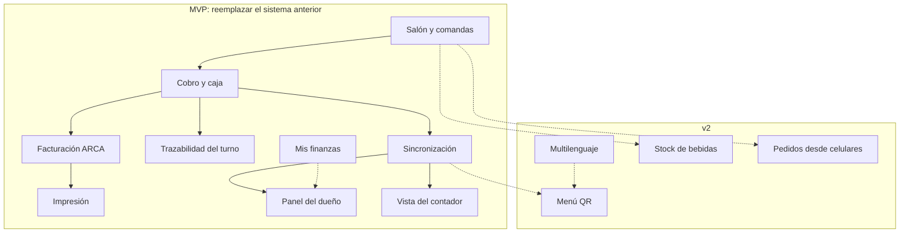
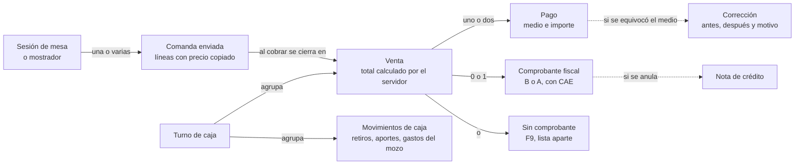
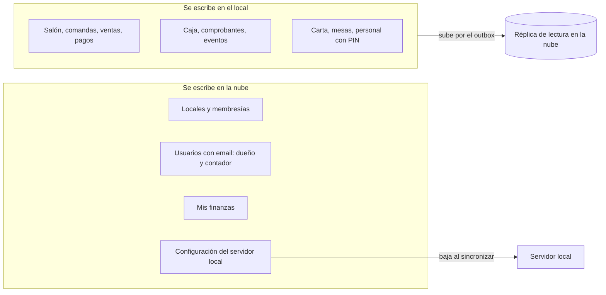

# Dominio: los conceptos del negocio

**Estado: modelo propuesto.**

Antes de las tablas y las clases, las palabras. Si los dos usan "venta" para cosas distintas, el código lo va a reflejar.

## DOM-01. Mapa de capacidades: MVP y v2

**Propósito:** ver de un vistazo qué se construye primero y qué queda para después. **Stories:** HU-132, HU-140, HU-162, HU-211, HU-261, HU-310, HU-320, HU-330.

<!-- diagram: DOM-01 -->

**Archivos DOM-01:** [SVG](svg/DOM-01.svg) · [PNG](png/DOM-01.png) · [Mermaid](fuentes/DOM-01.mmd).

**Lectura:** línea continua = dependencia dentro del MVP; punteada = lo que habilita después. El menú QR se apoya en la carta sincronizada; el stock, en las comandas.

## DOM-02. Del pedido al comprobante

**Propósito:** separar comanda, venta, pago, comprobante y turno. Al analizar sistemas anteriores se ve seguido que sumar comandas y comprobantes como si fueran ventas da totales que no cierran. **Stories:** HU-135, HU-140, HU-142, HU-162, HU-165, HU-226, HU-223.

<!-- diagram: DOM-02 -->

**Archivos DOM-02:** [SVG](svg/DOM-02.svg) · [PNG](png/DOM-02.png) · [Mermaid](fuentes/DOM-02.mmd).

**Lectura:** la **venta** es el hecho económico (lo que se cobró). El **comprobante** es su documento fiscal y puede no existir (sin comprobante) o estar pendiente (sin CAE todavía). La comanda no es venta: una mesa puede tener varias comandas y una sola venta.

**Casos para validar:** el total de ventas del turno no cambia si una factura queda pendiente; anular una venta facturada pide nota de crédito; corregir un medio de pago no toca la factura.

## DOM-03. ¿De quién es cada dato?

**Propósito:** la regla que evita conflictos de sincronización: cada dato se escribe en un solo lugar. **Stories:** HU-120, HU-112, HU-243, HU-211, HU-255, HU-260.

<!-- diagram: DOM-03 -->

**Archivos DOM-03:** [SVG](svg/DOM-03.svg) · [PNG](png/DOM-03.png) · [Mermaid](fuentes/DOM-03.mmd).

**Lectura:** si un dato tiene un solo dueño, nunca hay dos versiones que reconciliar. Si mañana el dueño quiere editar precios desde el celular (P-01), la carta cambia de columna y pasa a bajar al local; el mecanismo es el mismo.
