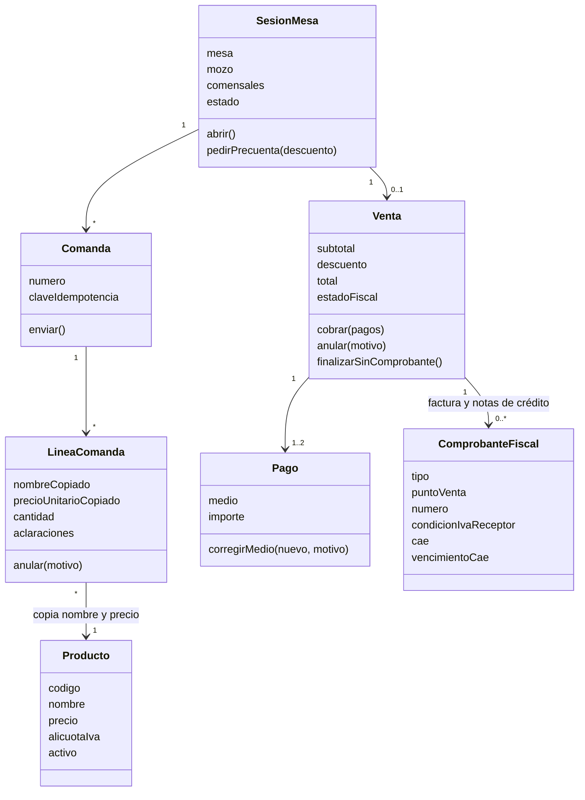
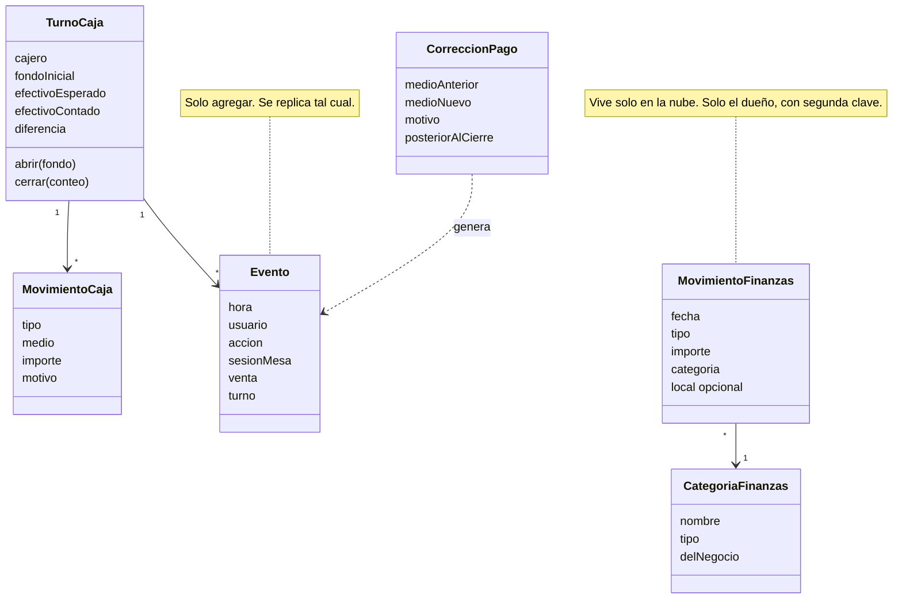

# Clases: responsabilidades del dominio

**Estado: modelo conceptual.** Un diagrama de clases conceptual no dice que ya existan esas clases en Python, ni cómo se llaman sus métodos. Dice qué responsabilidad tiene cada concepto.

## CLA-01. Salón y venta

**Propósito:** ubicar las reglas de la operación diaria en el objeto que las tiene que cumplir. **Stories:** HU-120, HU-131, HU-135, HU-140, HU-142, HU-162.

<!-- diagram: CLA-01 -->

**Archivos CLA-01:** [SVG](svg/CLA-01.svg) · [PNG](png/CLA-01.png) · [Mermaid](fuentes/CLA-01.mmd).

**Lectura:** `LineaComanda` copia nombre y precio del producto: un cambio de carta nunca reescribe una venta pasada. `Venta` decide su total; la pantalla solo lo muestra. `Venta` tiene hasta dos pagos, como en el prototipo.

## CLA-02. Caja, trazabilidad y Mis finanzas

**Propósito:** separar la caja del turno (en el local) de la libreta del dueño (en la nube), y mostrar dónde se apoya la trazabilidad. **Stories:** HU-150, HU-152, HU-220, HU-223, HU-225, HU-210, HU-212.

<!-- diagram: CLA-02 -->

**Archivos CLA-02:** [SVG](svg/CLA-02.svg) · [PNG](png/CLA-02.png) · [Mermaid](fuentes/CLA-02.mmd).

**Lectura:** el turno calcula su efectivo esperado con ventas en efectivo, movimientos y gastos; nunca se edita cerrado. Las correcciones y los eventos son de solo agregar. Mis finanzas no conoce a la caja: el panel los cruza (HU-182).
