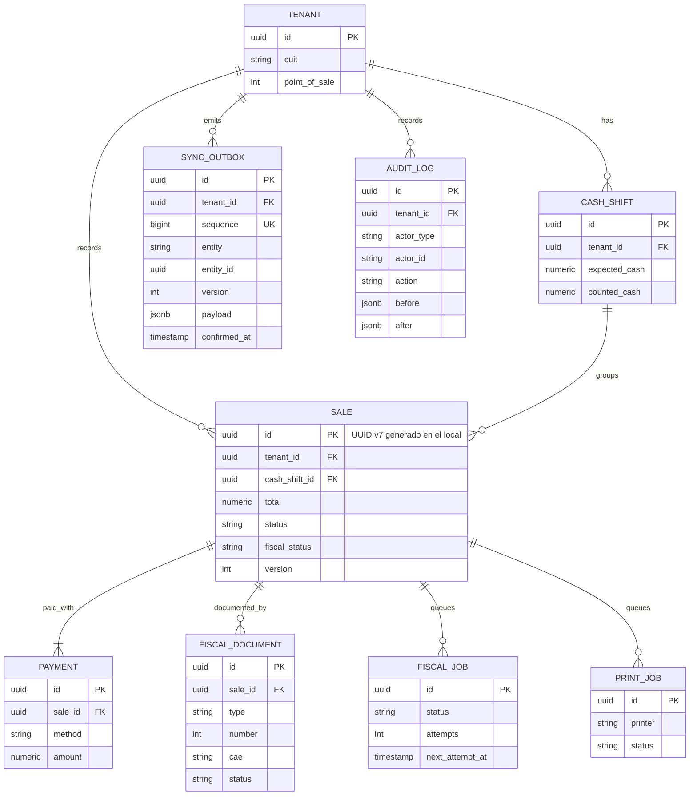
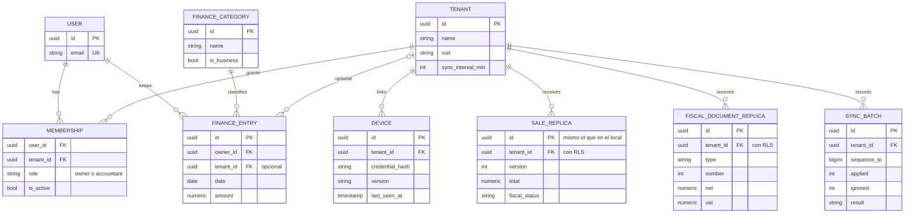

# Datos: base local y base en la nube

**Estado: modelo propuesto.** Muestra las tablas que importan para entender local first y tenants, no el esquema completo. Los nombres son los del código (en inglés); el [glosario](../producto/glosario.md) da su equivalente en español.

## DAT-01. Base local: núcleo de venta y outbox

**Propósito:** mostrar cómo cada operación deja su rastro para la sincronización y la auditoría. **Stories:** HU-100, HU-140, HU-244, HU-260.

<!-- diagram: DAT-01 -->

**Archivos DAT-01:** [SVG](svg/DAT-01.svg) · [PNG](png/DAT-01.png) · [Mermaid](fuentes/DAT-01.mmd).

**Lectura:** cobrar escribe en una transacción: `SALE`, `PAYMENT`, `FISCAL_JOB`, `PRINT_JOB`, `AUDIT_LOG` y `SYNC_OUTBOX`. Si algo falla, no queda nada. Los trabajos y el outbox son tablas usadas como colas.

## DAT-02. Base en la nube: locales, membresías, réplica y finanzas

**Propósito:** mostrar qué es réplica, qué es propio de la nube y cómo se aísla. **Stories:** HU-240, HU-241, HU-243, HU-263, HU-264, HU-210.

<!-- diagram: DAT-02 -->

**Archivos DAT-02:** [SVG](svg/DAT-02.svg) · [PNG](png/DAT-02.png) · [Mermaid](fuentes/DAT-02.mmd).

**Lectura:** las tablas `_REPLICA` guardan el mismo `id` que en el local, así el upsert es directo. `MEMBERSHIP` es la única puerta de acceso a un local. `FINANCE_ENTRY` cuelga del dueño; el `tenant_id` es opcional para el resultado por local.
