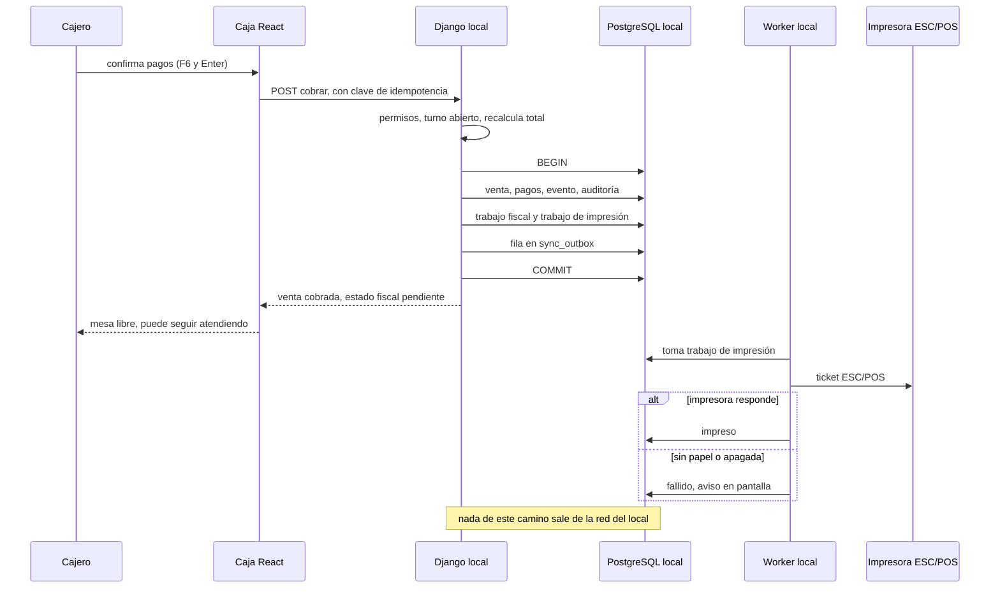
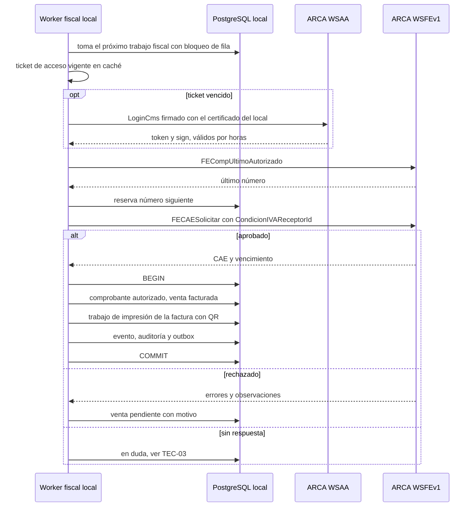
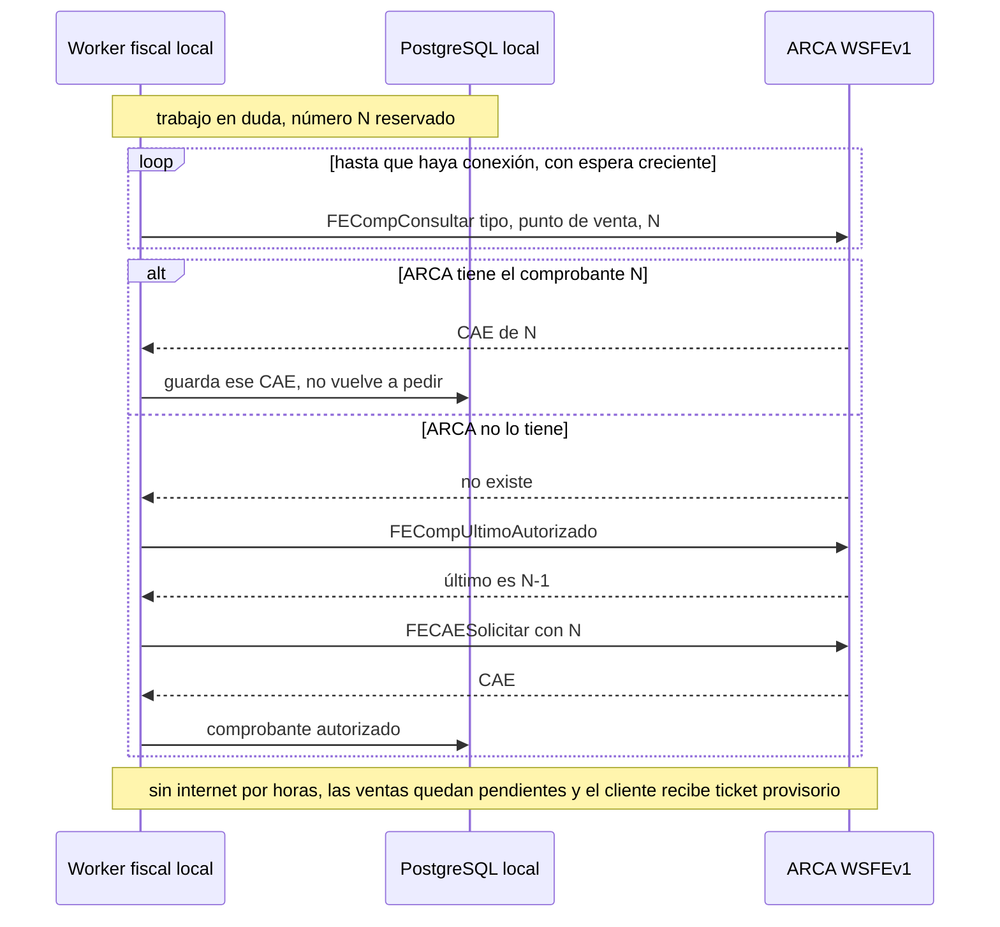
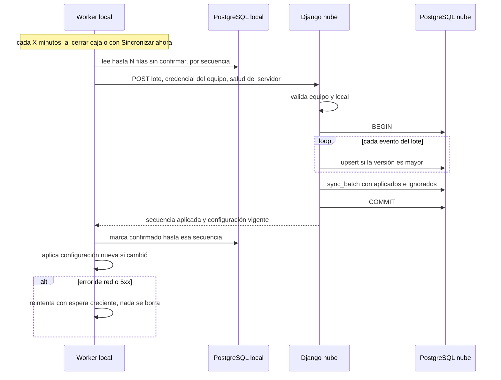
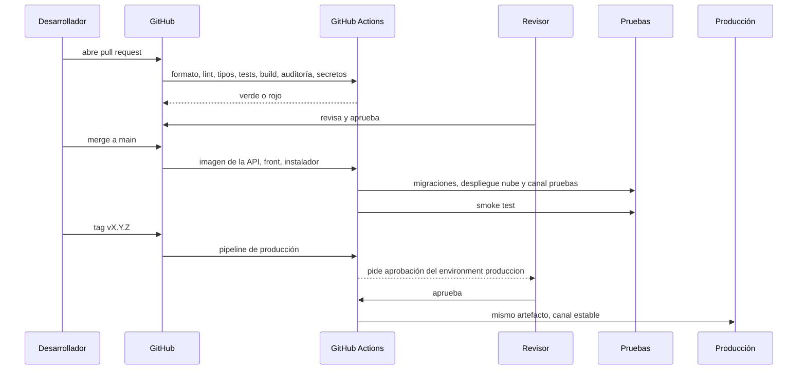
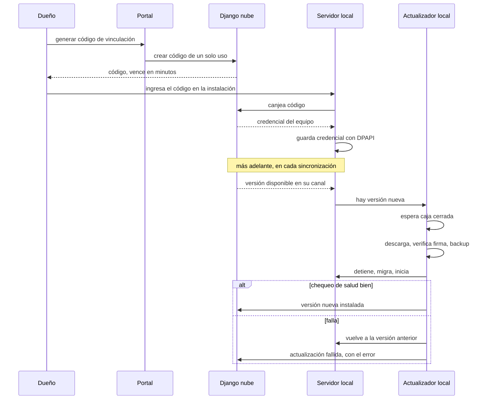

# Secuencias técnicas

**Estado: diseño objetivo.** Las secuencias muestran el orden de las llamadas y dónde está cada transacción.

## TEC-01. Cobrar e imprimir sin esperar a ARCA

**Propósito:** el camino crítico de la velocidad. El cajero ve "cobrado" apenas la venta está guardada en la base local. **Stories:** HU-140, HU-171, HU-271.

<!-- diagram: TEC-01 -->

**Archivos TEC-01:** [SVG](svg/TEC-01.svg) · [PNG](png/TEC-01.png) · [Mermaid](fuentes/TEC-01.mmd).

**Lectura:** la respuesta al cajero llega después del COMMIT y antes de cualquier trabajo lento. La impresión y ARCA corren después, en el worker. Si se repite la misma solicitud con la misma clave, se devuelve la venta ya creada.

## TEC-02. Emitir la factura con CAE

**Propósito:** cómo el worker local pide el CAE y qué guarda. **Stories:** HU-161, HU-162, HU-163, HU-166.

<!-- diagram: TEC-02 -->

**Archivos TEC-02:** [SVG](svg/TEC-02.svg) · [PNG](png/TEC-02.png) · [Mermaid](fuentes/TEC-02.mmd).

**Lectura:** el certificado nunca sale del servidor local. El neto, IVA y total que se envían salen de la venta guardada y se comparan al centavo con la respuesta. La condición frente al IVA del receptor va siempre (RG 5616).

## TEC-03. Reintento seguro: nunca dos facturas, nunca un número salteado

**Propósito:** el caso difícil. Se cortó internet justo después de pedir el CAE: no sabemos si ARCA lo autorizó. **Stories:** HU-164, HU-168.

<!-- diagram: TEC-03 -->

**Archivos TEC-03:** [SVG](svg/TEC-03.svg) · [PNG](png/TEC-03.png) · [Mermaid](fuentes/TEC-03.mmd).

**Lectura:** primero se pregunta, después se pide. Así un reintento nunca duplica. La alternativa CAEA (RG 5782) para cortes largos se evalúa en el spike HU-168; depende del contador (P-10).

## TEC-04. Sincronización por outbox

**Propósito:** cómo llegan los datos a la nube cada X y al cerrar caja. **Stories:** HU-260, HU-261, HU-262, HU-263, HU-264, HU-255.

<!-- diagram: TEC-04 -->

**Archivos TEC-04:** [SVG](svg/TEC-04.svg) · [PNG](png/TEC-04.png) · [Mermaid](fuentes/TEC-04.mmd).

**Lectura:** el lote se aplica entero o no se aplica. Repetir un lote no cambia nada (upsert por versión). La configuración remota viaja en la respuesta: la nube nunca llama al local.

## TEC-05. Del pull request a producción

**Propósito:** el camino de un cambio, con sus controles. **Stories:** HU-230, HU-233, HU-234, HU-235, HU-271.

<!-- diagram: TEC-05 -->

**Archivos TEC-05:** [SVG](svg/TEC-05.svg) · [PNG](png/TEC-05.png) · [Mermaid](fuentes/TEC-05.mmd).

**Lectura:** nadie mergea su propio PR; producción recibe exactamente lo que se probó. El servidor del local toma la versión nueva del canal estable recién al cerrar la caja (TEC-06).

## TEC-06. Vincular el servidor local y actualizarlo a distancia

**Propósito:** el principio 3 de `CONTRIBUTING.md`, actualizable a distancia, en una secuencia. **Stories:** HU-252, HU-254, HU-255.

<!-- diagram: TEC-06 -->

**Archivos TEC-06:** [SVG](svg/TEC-06.svg) · [PNG](png/TEC-06.png) · [Mermaid](fuentes/TEC-06.mmd).

**Lectura:** el código de vinculación es de un solo uso y vence; la credencial que queda es propia del equipo y se puede revocar desde el portal. Una actualización nunca corre con la caja abierta.
