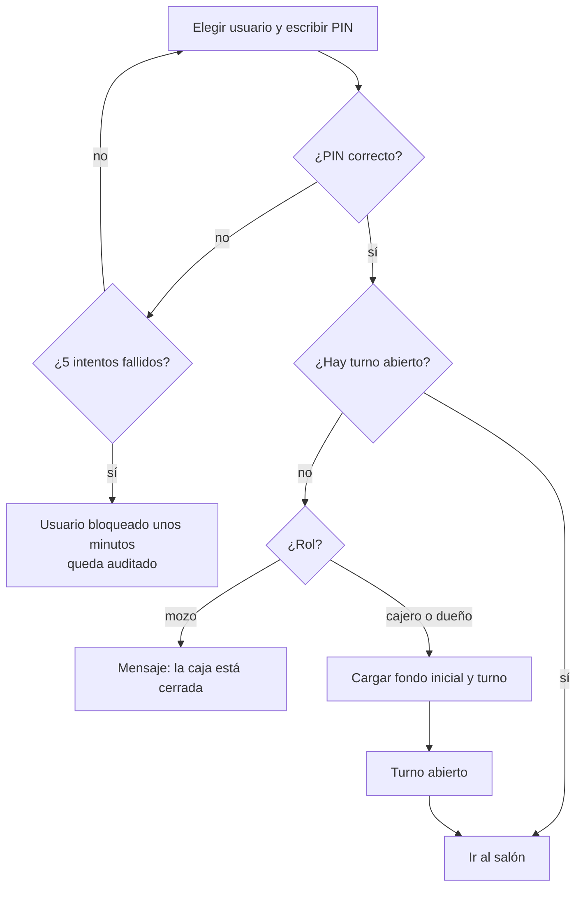
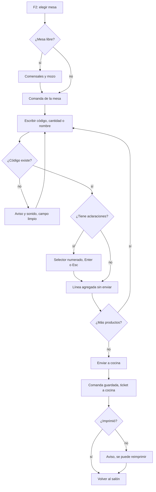
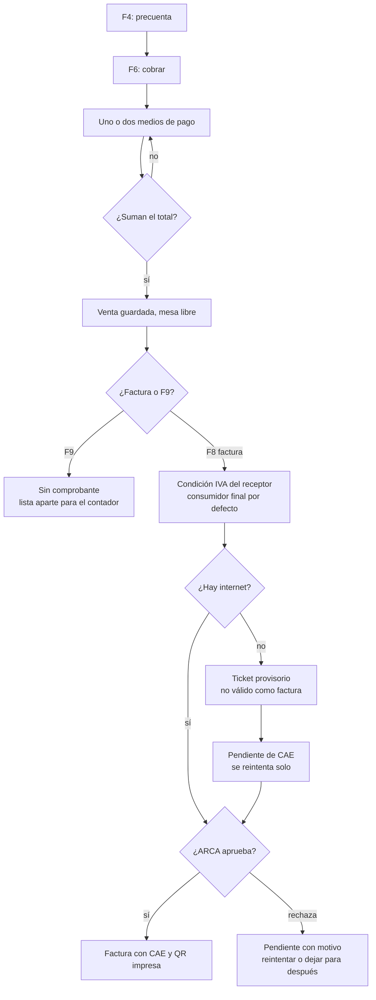
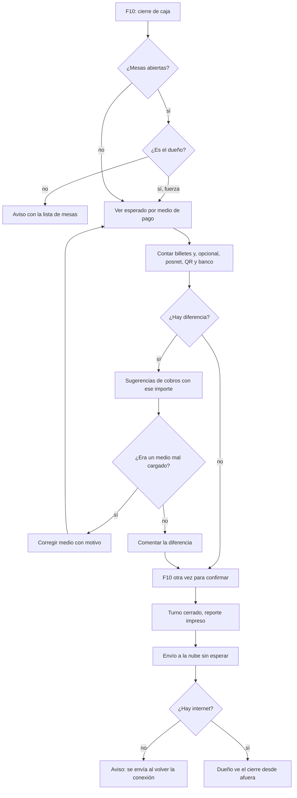
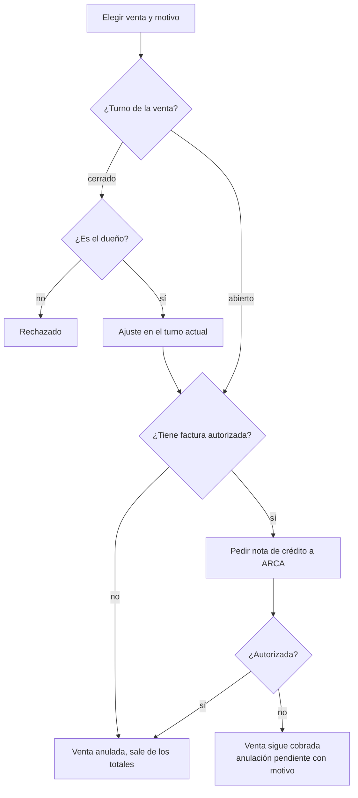
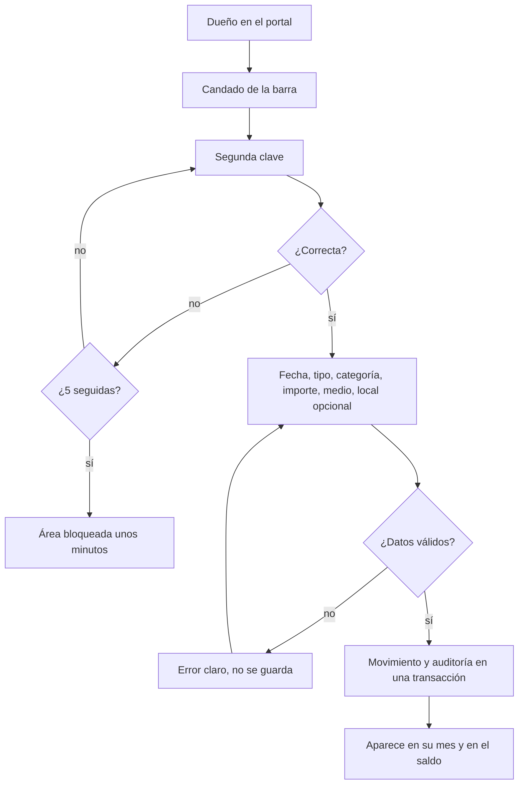
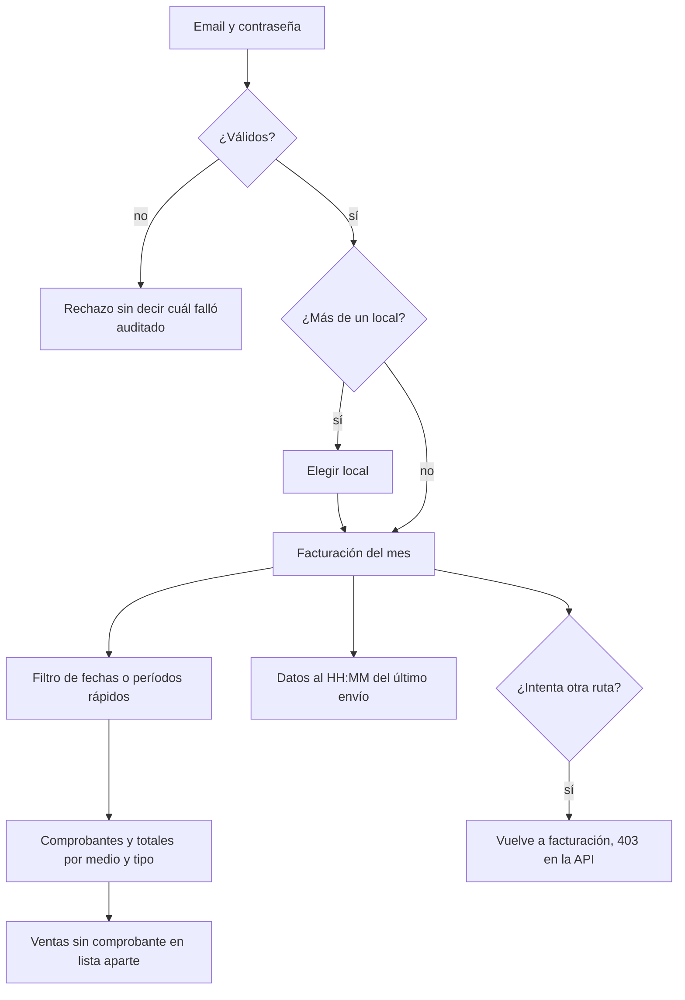

# Flujos funcionales: lo que hace la persona

**Estado: diseño objetivo, basado en el prototipo.** Cada flujo muestra decisiones y qué pasa ante errores. Las teclas son las del prototipo; la configuración final vive en un solo archivo del frontend (HU-102).

## FUN-01. Ingresar con PIN y abrir la caja

**Stories:** HU-110, HU-113, HU-150.

<!-- diagram: FUN-01 -->

**Archivos FUN-01:** [SVG](svg/FUN-01.svg) · [PNG](png/FUN-01.png) · [Mermaid](fuentes/FUN-01.mmd).

**Lectura:** todo el flujo funciona sin internet: el PIN lo valida el servidor local.

## FUN-02. Abrir una mesa y cargar la comanda por código

**Stories:** HU-131, HU-132, HU-133, HU-134, HU-135, HU-130.

<!-- diagram: FUN-02 -->

**Archivos FUN-02:** [SVG](svg/FUN-02.svg) · [PNG](png/FUN-02.png) · [Mermaid](fuentes/FUN-02.mmd).

**Lectura:** una impresora sin papel avisa pero no frena: la comanda ya está guardada.

## FUN-03. Cobrar, facturar o finalizar sin comprobante

**Stories:** HU-136, HU-140, HU-162, HU-164, HU-226, HU-172.

<!-- diagram: FUN-03 -->

**Archivos FUN-03:** [SVG](svg/FUN-03.svg) · [PNG](png/FUN-03.png) · [Mermaid](fuentes/FUN-03.mmd).

**Lectura:** el cobro termina en "venta guardada" sin importar lo que pase después. El ticket provisorio está pendiente de validación con el contador (P-10).

## FUN-04. Cerrar la caja

**Stories:** HU-152, HU-153, HU-224, HU-262.

<!-- diagram: FUN-04 -->

**Archivos FUN-04:** [SVG](svg/FUN-04.svg) · [PNG](png/FUN-04.png) · [Mermaid](fuentes/FUN-04.mmd).

**Lectura:** Enter no cierra la caja: hace falta F10 dos veces, a propósito. El envío a la nube nunca bloquea el cierre.

## FUN-05. Anular una venta

**Stories:** HU-142, HU-165.

<!-- diagram: FUN-05 -->

**Archivos FUN-05:** [SVG](svg/FUN-05.svg) · [PNG](png/FUN-05.png) · [Mermaid](fuentes/FUN-05.mmd).

## FUN-06. Mis finanzas: cargar un movimiento

**Stories:** HU-211, HU-212, HU-214.

<!-- diagram: FUN-06 -->

**Archivos FUN-06:** [SVG](svg/FUN-06.svg) · [PNG](png/FUN-06.png) · [Mermaid](fuentes/FUN-06.mmd).

**Lectura:** este flujo no pasa por el local; vive en la nube.

## FUN-07. El contador consulta la facturación

**Stories:** HU-200, HU-201, HU-202, HU-203, HU-242.

<!-- diagram: FUN-07 -->

**Archivos FUN-07:** [SVG](svg/FUN-07.svg) · [PNG](png/FUN-07.png) · [Mermaid](fuentes/FUN-07.mmd).

**Lectura:** el contador ve solo facturación (decisión del 05/10/2026). La hora visible evita que trabaje con datos viejos sin saberlo.
