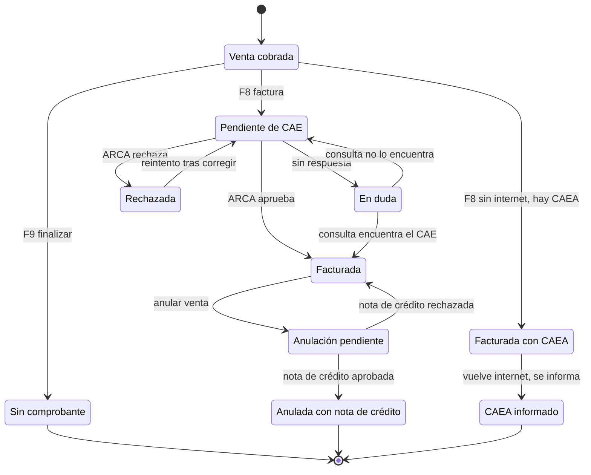
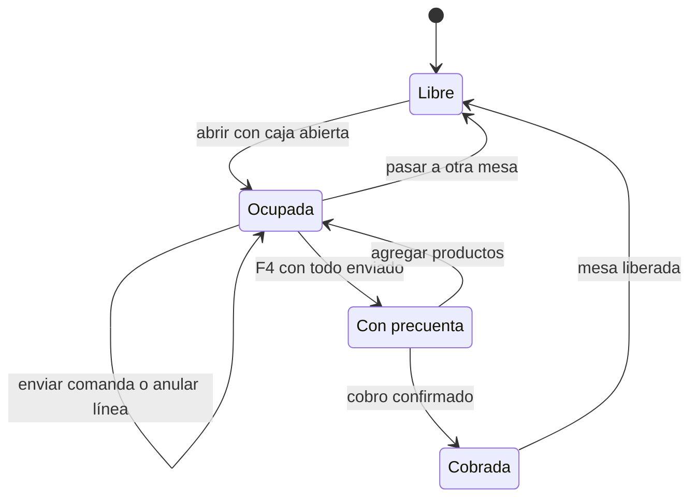
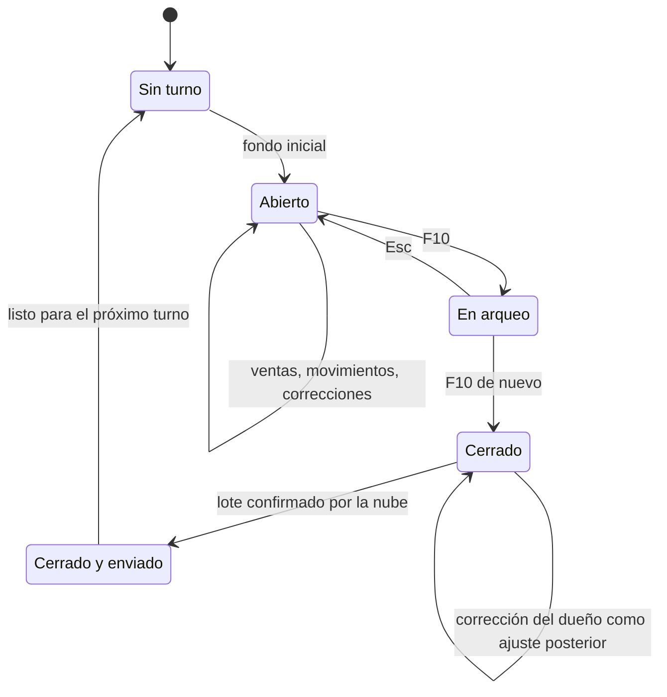
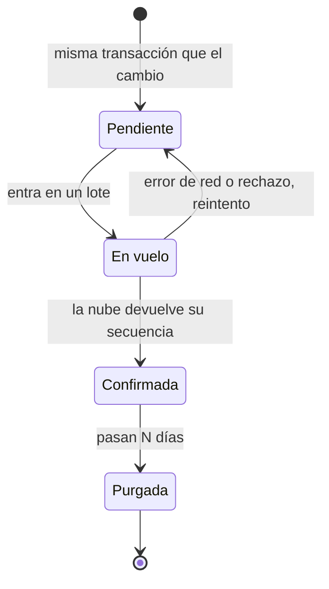

# Estados: qué cambios son válidos

**Estado: diseño objetivo.** Cada máquina de estados vive en un solo lugar del código (el servicio de dominio) y rechaza las transiciones que no están dibujadas.

## EST-01. Comprobante fiscal

**Stories:** HU-162, HU-164, HU-165, HU-226, HU-168, HU-169.

<!-- diagram: EST-01 -->

**Archivos EST-01:** [SVG](svg/EST-01.svg) · [PNG](png/EST-01.png) · [Mermaid](fuentes/EST-01.mmd).

**Lectura:** "Sin comprobante" es final: no se puede facturar después. "En duda" existe para no duplicar: antes de volver a pedir, se consulta (TEC-03). Sin internet, si hay CAEA vigente, la factura es válida en el momento y después se informa; "Pendiente de CAE" queda solo como último recurso.

## EST-02. Sesión de mesa

**Stories:** HU-130, HU-131, HU-136, HU-137, HU-140.

<!-- diagram: EST-02 -->

**Archivos EST-02:** [SVG](svg/EST-02.svg) · [PNG](png/EST-02.png) · [Mermaid](fuentes/EST-02.mmd).

## EST-03. Turno de caja

**Stories:** HU-150, HU-152, HU-154, HU-223, HU-262.

<!-- diagram: EST-03 -->

**Archivos EST-03:** [SVG](svg/EST-03.svg) · [PNG](png/EST-03.png) · [Mermaid](fuentes/EST-03.mmd).

**Lectura:** un turno cerrado nunca se edita; lo que se corrige después queda como ajuste. "Cerrado y enviado" no es necesario para abrir el siguiente turno: es informativo.

## EST-04. Fila del outbox y lote de sincronización

**Stories:** HU-260, HU-261, HU-263, HU-265.

<!-- diagram: EST-04 -->

**Archivos EST-04:** [SVG](svg/EST-04.svg) · [PNG](png/EST-04.png) · [Mermaid](fuentes/EST-04.mmd).

**Lectura:** una fila vuelve a pendiente cuantas veces haga falta; reenviar no duplica porque la nube aplica por versión. Si una fila queda pendiente más que el umbral, la nube alerta (HU-265).
