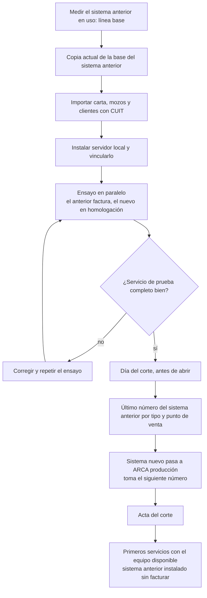
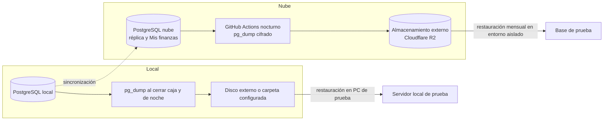
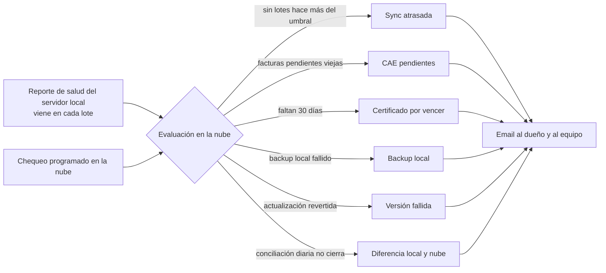

# Operación: corte, backups y alertas

**Estado: propuesta.**

## OPS-01. Del sistema anterior al nuevo

**Propósito:** el corte en pasos, con un solo emisor de comprobantes en cada momento. **Stories:** HU-123, HU-194, HU-250, HU-270, HU-280, HU-281.

<!-- diagram: OPS-01 -->

**Archivos OPS-01:** [SVG](svg/OPS-01.svg) · [PNG](png/OPS-01.png) · [Mermaid](fuentes/OPS-01.mmd).

**Lectura:** en ningún momento facturan los dos sistemas contra ARCA producción. El sistema anterior queda como respaldo operativo, no fiscal.

## OPS-02. Backups y restauración

**Propósito:** qué se copia, dónde y cómo se prueba. **Stories:** HU-246, HU-253, HU-254.

<!-- diagram: OPS-02 -->

**Archivos OPS-02:** [SVG](svg/OPS-02.svg) · [PNG](png/OPS-02.png) · [Mermaid](fuentes/OPS-02.mmd).

**Lectura:** la réplica no es un backup (si se borra algo en el local, se replica el borrado lógico). Un backup cuenta recién cuando se restauró al menos una vez.

## OPS-03. Alertas operativas

**Propósito:** enterarse antes que el cliente. **Stories:** HU-161, HU-245, HU-255, HU-265, HU-266.

<!-- diagram: OPS-03 -->

**Archivos OPS-03:** [SVG](svg/OPS-03.svg) · [PNG](png/OPS-03.png) · [Mermaid](fuentes/OPS-03.mmd).

**Lectura:** la alerta de sincronización atrasada es la más importante: es la que detecta la falla silenciosa.
