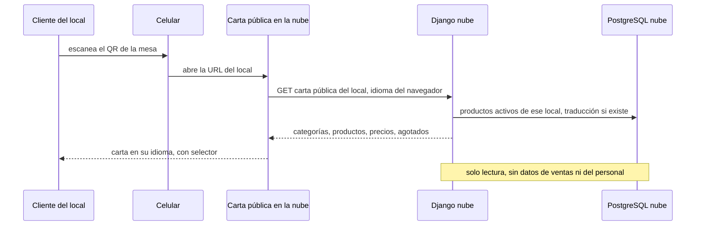
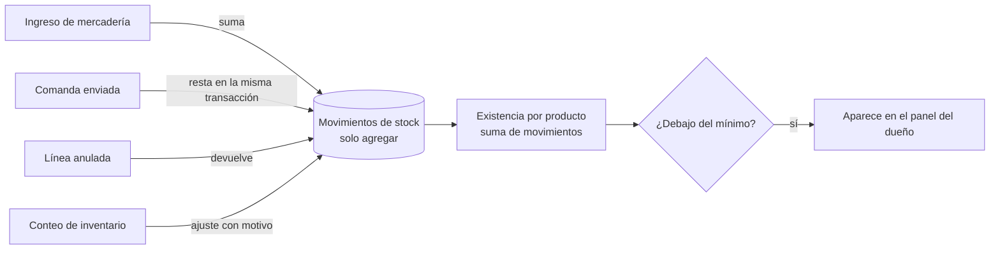

# Versión 2: menú QR y stock de bebidas

**Estado: idea para conversar, sin diseño detallado ni estimación.**

## FUT-01. Menú QR multilenguaje

**Stories:** HU-300, HU-302, HU-310, HU-311.

<!-- diagram: FUT-01 -->

**Archivos FUT-01:** [SVG](svg/FUT-01.svg) · [PNG](png/FUT-01.png) · [Mermaid](fuentes/FUT-01.mmd).

**Lectura:** la carta pública se arma con la réplica de la nube, así que muestra los precios al último envío del local. Para que un cambio de precio aparezca enseguida, el cambio de carta puede disparar un envío inmediato.

## FUT-02. Stock de bebidas

**Stories:** HU-320, HU-321, HU-322, HU-323, HU-324.

<!-- diagram: FUT-02 -->

**Archivos FUT-02:** [SVG](svg/FUT-02.svg) · [PNG](png/FUT-02.png) · [Mermaid](fuentes/FUT-02.mmd).

**Lectura:** la existencia no se guarda "a mano": es la suma de movimientos. Vender sin stock se permite y avisa, para no frenar la caja. El stock general queda fuera de alcance; esto cubre el control de bebidas pedido para v2 (P-18).
